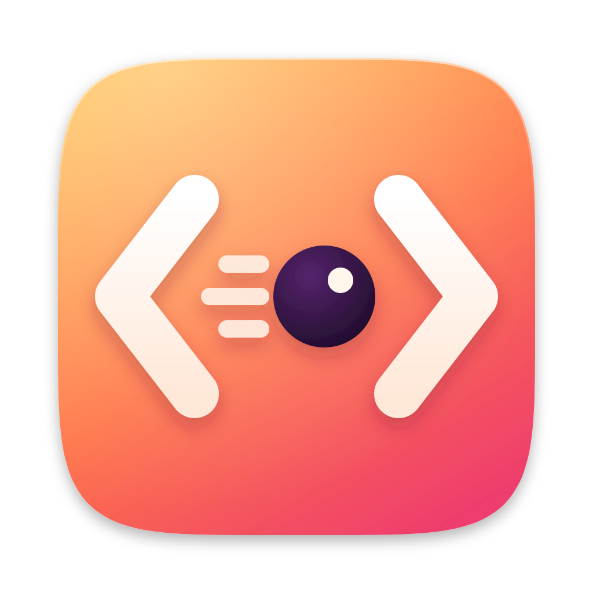

<p align="center">
  
</p>

<h1 align="center">ProxyGo</h1>

<p align="center">
  A native macOS debugging proxy for HTTP, HTTPS and WebSocket traffic.
</p>

<p align="center">
  <a href="https://github.com/tacshi/ProxyGo/releases/latest"></a>
  <a href="#requirements"></a>
  <a href="https://go.dev"></a>
  <a href="#mcp-for-ai-assistants"></a>
  <a href="https://github.com/egoist/mygo"></a>
</p>

ProxyGo records what your Mac, phones and other devices send and receive,
decrypts the HTTPS hosts you choose, and lets you replay, rewrite, mock, slow
down or block requests while you build and debug apps and APIs.

It is written in Go with [MyGo](https://github.com/egoist/mygo), and is
driven three ways: from its window, from a terminal with `proxygo-cli`, and
from AI assistants over the Model Context Protocol (MCP).

## Features

### Capture and inspect

- HTTP/1.1, HTTP/2 and WebSocket traffic, through an HTTP proxy (port 9090 by
  default) or SOCKS5 for apps that ignore the system proxy.
- HTTPS decryption per host, with a root certificate that ProxyGo generates
  and installs. You can also bring your own root, custom server certificates
  and client certificates.
- An inspector for headers, query strings, cookies, forms, timing and TLS.
  Bodies are decoded and previewed as JSON, XML, images, JWT,
  MessagePack, Server-Sent Events and Protobuf (with your `.proto` schemas).
- The app that sent each request, and the remote devices using the proxy.
- An overview of the session: requests over time by outcome, response time
  percentiles, status codes, errors grouped by reason and domain, top hosts
  and apps, and the HTTPS hosts not yet decrypted.
- A filter bar, an advanced filter that combines conditions, saved presets,
  pinned hosts and apps, comments, highlights, and configurable columns.

### Debug

| Tool | What it does |
| --- | --- |
| Repeat and Compose | Send a request again, as captured or edited, or write a new one |
| Breakpoints | Pause matching requests or responses and edit them before they go on |
| Map Local | Answer requests with a local file or a response written in ProxyGo |
| Map Remote | Send requests to another host, port or path, such as staging or localhost |
| Scripting | Change requests and responses with JavaScript |
| Network Conditions | Add latency, limit bandwidth or drop packets, from presets such as 3G |
| Block List and Allow List | Refuse matching requests, or everything but them |
| DNS Spoofing | Resolve a host to another address |
| Reverse Proxy | Listen on a local port and forward to a server |
| No Caching | Strip caching headers so every request reaches the server |
| External Proxy | Send traffic on through an upstream HTTP, HTTPS or PAC proxy |

Every tool can be switched on and off as a whole, keeping its rules, and the
rules export to a file and import back.

### Share and reuse

- Sessions save and open as `.proxygosession` files. HAR and Charles sessions
  can be imported.
- Export as HAR, CSV, raw HTTP, a Postman collection, or OpenAPI in YAML or
  HTML.
- Copy a request as cURL or as code in about twenty languages and libraries,
  including Go, Python, JavaScript, Swift, Kotlin, Java, Rust and PHP.
- Compare two flows side by side, or in a diff tool of your own.

### Set up

- One switch points macOS at ProxyGo and gives the previous proxy back
  afterwards. A small helper, approved once with an administrator password,
  makes the change, so later switches need no prompt.
- Automatic Setup opens a terminal, a browser or an Electron app that already
  goes through ProxyGo, without changing system settings.
- Phones and other devices get the certificate from <http://proxy.go> while
  they use the proxy. The Certificate menu has steps for iOS and Android.
- A menu bar icon, light and dark appearances, and a choice of app icons.
- Installed copies update themselves from GitHub Releases.

## Requirements

- macOS 14 or later.
- To build from source: Go 1.27.3 or later. The build scripts also need Xcode.

## Getting started

1. **Send traffic to ProxyGo.** Turn on *Tools › Override macOS Proxy*, or set
   a device's HTTP proxy to your Mac's address and port 9090.
2. **Trust the certificate.** Choose *Certificate › Install Certificate on this
   Mac*. On a phone, open <http://proxy.go> while it uses ProxyGo, install the
   profile and trust it.
3. **Decrypt HTTPS.** Encrypted tunnels show a lock. Choose *Enable only this
   domain* in the response pane, or add hosts in *Tools › SSL Proxying List*.
4. **Debug.** Select a flow to inspect it, then repeat, compose, break on, map
   or script the requests you are working on.

*Help › Getting Started* covers the same steps and lists the keyboard
shortcuts. The command palette (⇧⌘P) reaches every command.

## Command line

`proxygo-cli` controls a running ProxyGo from a terminal or a script. Install
it from *Settings › Automation*, which links it at `/usr/local/bin/proxygo-cli`.

```sh
proxygo-cli status                        # ProxyGo's state, as JSON
proxygo-cli proxy on                      # point macOS at ProxyGo
proxygo-cli recording off                 # pause recording
proxygo-cli map-remote on                 # switch a tool on
proxygo-cli rules block-list list         # a tool's rules, as JSON
proxygo-cli export-log --output session.har --format har
proxygo-cli clear-session
```

`proxygo-cli` with no arguments lists every command, including editing,
importing and exporting rules, certificates and MCP.

## MCP for AI assistants

ProxyGo serves MCP so that assistants such as Claude, Cursor and Windsurf can
read the traffic, explain failures and add rules. Its tools list and filter
flows, read a flow's request, response, timing and WebSocket messages,
generate code, export sessions, and create Map Local, Map Remote, Breakpoint,
Block, Allow, Script, DNS and Network Condition rules.

Turn it on in *Settings › Automation*, or with `proxygo-cli mcp on`, then
print the configuration for your client:

```sh
proxygo-cli mcp config
```

For Claude Code, this is one command:

```sh
claude mcp add proxygo -- proxygo-cli mcp-server
```

Credentials in headers and bodies are redacted from what assistants see
unless you choose otherwise in Settings.

## Building from source

```sh
git clone https://github.com/tacshi/ProxyGo.git
cd ProxyGo
go run .
```

Scripts for macOS builds:

| Script | Builds |
| --- | --- |
| `scripts/build-mac-debug.sh [--open]` | `build/mac-debug/ProxyGo-debug.app`, an ad hoc signed debug build with its own name, bundle identifier, data folder and icon, so it runs beside a release copy |
| `scripts/build-mac-release.sh [<version>]` | Signed and notarized disk images for Apple silicon, Intel and universal, with signed update archives |
| `scripts/publish.sh <version> [--dry-run]` | A release on GitHub: checks, release notes from `CHANGELOG.md`, the build, the tag and the published release |

Run any script with `--help` for its options. Release builds need a Developer
ID Application identity, a `notarytool` keychain profile and the update
signing key; `scripts/build-mac-release.sh --help` explains each one.

### Tests

```sh
CGO_ENABLED=0 go test ./...
go tool mygo vet .
```

### Data

ProxyGo keeps its settings, rules, certificates and sessions in
`~/Library/Application Support/ProxyGo`, or in the folder that
`PROXYGO_DATA_DIR` names. *Help › Open Data Folder* opens it.

## Project layout

| Path | Contents |
| --- | --- |
| `main.go` | Entry point: the app, the CLI and the privileged helper |
| `cmd/proxygo-cli` | The standalone command line tool |
| `internal/app` | Windows, menus, the flow list, inspector and tool editors |
| `internal/proxy` | The proxy: HTTP, HTTPS, HTTP/2, WebSocket, SOCKS5, reverse proxy, throttling |
| `internal/rules` | Rule matching and the debugging tools' rules |
| `internal/script` | The JavaScript runtime for scripting rules |
| `internal/certs` | Root and custom certificates, and trusting them |
| `internal/session` | Session files, imports and exports |
| `internal/codegen` | Copy as code |
| `internal/mcp` | The MCP server |
| `internal/cli`, `internal/control` | `proxygo-cli` and the local control socket it uses |
| `internal/privileged` | The helper that changes the macOS proxy |
| `third_party/mygo-ui` | MyGo's UI package, with ProxyGo's patches |

## Acknowledgments

ProxyGo is built on [MyGo](https://github.com/egoist/mygo) (MIT). See
[`third_party/NOTICE`](third_party/NOTICE) and
[`third_party/MyGo-LICENSE`](third_party/MyGo-LICENSE).
